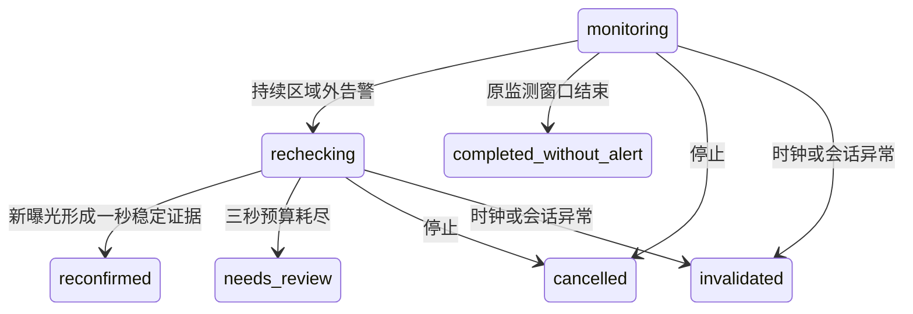

# 告警后的有限视觉复查

2026-11-03。新增 `PostAlertVerification`：从已有释放成功结果开始监测，一旦持续区域外证据触发告警，自动进入一次独立复查。复查产生重新确认、需人工复核、取消或失效的明确结果。它推进的是视觉证据决策流程，尚未接入机械补救动作、网页或采集进程拥有权。

同日后续新增[采集进程驱动的复查适配器](process-post-alert-verification.md)，可从成功观察器交接并主动请求新帧。本页描述的纯状态机仍负责处理观测，采集与资源回收由新适配器负责。

## 状态与时间边界



- 初始监测默认 2 秒，沿用 `PostConfirmationWatch` 的保守确认区域和持续 250 ms 区域外告警规则。
- 复查从告警**送达任务时刻**开始，固定 3 秒，只尝试一次。触发告警的帧不复用，曝光时刻早于或等于复查起点的迟到帧也不参与。
- 重新确认沿用 `ExposureConfirmation`：区域内曝光持续至少 1 秒，相邻间隔不超过 250 ms，速度小于 0.02 m/s；使用曝光时间积累稳定证据，送达时间限制截止期限。
- 缺失、重复、过期、非法坐标会打断稳定累计，不能刷新截止时间。抖动或单帧回归不能直接解除复查。
- 即使没有新观测，也检查时钟映射、单调性和相机会话；失配则终止。停止优先于输入校验。所有终态锁定，后续调用不会重新尝试或改写结果。
- 告警发生在原监测窗口末尾时，可继续使用自己的 3 秒复查预算；总预算不超过原监测截止时间加 3 秒。

原始成功确认、历史区域外告警和新的复查结果分别保留。`reconfirmed` 只表示在新窗口内重新得到稳定视觉证据；不删除历史告警，也不保证之后持续安全。`completed_without_alert` 仅表示窗口内未触发告警，全程缺帧也可能得到该状态，不能当成成功证据。区域外仍不是确定掉落，`needs_review` 也不等于物理失败。

## 接口

```python
from embodied_agent.post_alert_verification import PostAlertVerification

supervisor = PostAlertVerification(
    confirmed_result, confirmation_delivery_time, camera_session_id, measured_clock_map
)
supervisor.step(task_now, host_now, stamped_position_or_none, session_id=camera_session_id)
report = supervisor.result()
```

调用方负责送入已经完成的采集结果，并在明确缺失时送入 None。它不是可直接替换 `ProcessPostConfirmation` 的进程适配器，不取得相机所有权，不请求帧、不重启相机、不关闭设备；不能与另一个消费者争用同一采集结果。后续接入采集循环时需区分“尚在等待采集”和“确实没有观测”，不能把每次空轮询当成丢帧。

复查到期仍需要调用 `step` 才会结算；没有后台线程。返回值是上次调用的快照。`events` 保存阶段转换任务时间；非法任务时间和停止事件使用最后有效任务时间，避免写入 NaN。`last_error` 保存复查入口拒绝观测的原因，`recheck` 保存底层曝光确认诊断。

## 72 个合成场景

评估先使用真实 `ExposureConfirmation` 算法生成初始成功确认，再测试 3 个区域外起点（1.25 / 1.5 / 2.25 秒）× 3 个送达延迟（0 / 62.5 / 125 ms）× 8 种后续情况。所有坐标由脚本生成，没有真实相机或机械动作。

| 后续情况 | 数量 | 最终结果 |
| --- | ---: | --- |
| 稳定返回区域内 | 9 | reconfirmed |
| 仅一帧返回、持续区域外、持续缺帧、区域内抖动 | 36 | needs_review |
| 会话更换、时钟漂移 | 18 | invalidated |
| 用户停止 | 9 | cancelled |

72 项与预先指定的场景期望一致，无不一致项。故意设置的弱对照规则是“告警后首次看到区域内坐标就解除”：它在短暂回归和抖动两组中提前解除 18 次，新流程在这些场景中均未重新确认。对照不是旧生产策略，也不是通过独立物理真值测得的误报率；不能把 0/72 不一致解释为真实环境的成功率。

完整结果含参数、对照解除时间、原确认、历史告警和阶段转换，见[评估报告](evaluations/post-alert-verification-v1.json)。

```sh
make post-alert-test
make post-alert-evaluate
```

默认输出 `outputs/post-alert-verification-v2.json`，可用 `POST_ALERT_OUTPUT` 指定新路径，已有文件不覆盖。

新增 11 项测试，覆盖状态转换、新旧曝光隔离、缺失/重复/非法帧打断、送达截止时间、时钟/会话异常、停止优先级、终态锁定、结果深拷贝及 72 场景对照。相关回归共 126 项通过：新增 11、曝光 14、释放 34、后续观测 9、进程后续观测 10、后续边界/覆盖/矩阵 48。Ruff 与差异检查通过。未训练、未执行机械恢复；下一步可接入独立的采集生命周期，让复查阶段真正调度新帧。
