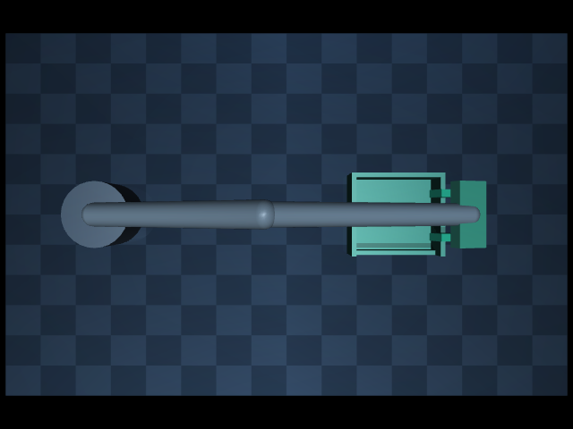

# 完整抓放回放中的释放观测分支

2026-10-25。将上一轮 RGB-D 落点确认接到完整动作回放的独立观测分支。ReleaseObserver 仅监听 intentional_release 事件，以 5 Hz 调用定位器，不提供动作或替代任务验收；生产 GuardedExecutor 默认路径未改动。

## 结果：发现机械臂遮挡，尚不能可靠确认

使用同一已知初始场景及正常历史动作回放，比较无信号滞后、9 帧释放滞后、前 0.6 秒缺失视觉和全程缺失视觉四种条件。每种分别关闭和开启观测，合计 8 次物理执行。所有案例固定运行到释放后 80 个控制周期，不依据视觉确认状态或质量成功提前结束。

| 条件 | 物理抓放验收 | 观测结论 | 是否符合预期 |
|---|---|---|---|
| 正常回放 | 成功 | unconfirmed | 否 |
| 9 帧释放滞后 | 成功 | unconfirmed | 否 |
| 前 0.6 秒缺失视觉 | 成功 | unconfirmed | 否 |
| 全程缺失视觉 | 成功 | unconfirmed | 是 |

四组的动作和每帧 qpos 均逐元素完全一致，质量报告也相同，支持本轮观测分支未改变执行。没有出现视觉误确认，但也没有任何成功确认，不能将结果表述为已经完成可靠的运行时落点验证。

正常和滞后案例的定位器持续报告未找到可见红色方块。根据保存的最终状态重渲染，机械臂与夹爪遮挡了托盘内物体，说明独立落点实验的可见性不能直接迁移到完整回放。物体终点真值约为 (0.6653, -0.0006, 0.0400) m，仅用于诊断，未传给视觉确认器。



这是最终帧的可见性证据；本轮没有重新规划撤臂，也没有把遮挡像素剔除后假装物体可见。前期缺失案例是主动屏蔽观测输入，不是新渲染的遮挡扰动。尚未覆盖倾斜物体或未见物体位置。

## 验证与复现

新增测试覆盖释放事件启动、5 Hz 采样、检测失败与终止状态不重启。核心 58 项、接触 31 项、释放相关 8 项，共 97 项测试通过。Ruff 与 diff 检查通过。物理实验的成功确认预期有 3 项未满足，评估命令因此以非零状态退出，并完整保存结果；这项实验验收没有通过。图形驱动仍有 ARB_clip_control 深度精度提示。

```sh
make release-observer-test
make release-observer-evaluate RELEASE_OBSERVER_OUTPUT=outputs/evaluations/release-observer-new
```

需要 config/contact-delayed-release.json 中带哈希的历史输入和 MuJoCo 图形连接；输出目录必须不存在。当前版本重现上述遮挡时，评估命令预期返回非零状态。

机器报告：[开关对照及逐次观测](evaluations/release-observer-v1.json)。原始 NPZ 位于 outputs/evaluations/release-observer-v1，未纳入 Git。报告保存源代码和输入哈希；开启视觉的结果不用于修改控制动作。

下一步应设计独立的撤臂观测姿态或第二视角，先验证无碰撞与可见性，再评估是否能在限定时间内取得连续落点证据。

后续[偏置观测视角对照](release-offset-view.md)在不改变动作的条件下解除本场景的遮挡，旧报告及失败结论保留。
